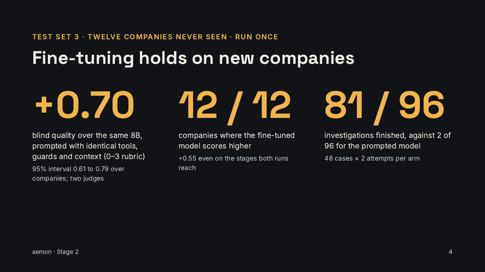

# aemon

<picture>
  <source media="(prefers-color-scheme: dark)" srcset="docs/figures/aemon-wordmark-dark.png">
  
</picture>

*weigh what is known. test what is not.*

**An open strategy investigator, distilled into Aya Expanse 8B with AgentTune and AuditKIT. On twelve companies it had
never seen, it beats the same model prompted by +0.70 at every company, and the fine-tuned weights and the harness's
guards turn out to need each other.**
Team Two-eyed Ravens · Lexsi AI Hackathon, Track 3 (Agentic Fine-Tuning) · November 2026 ·
**Video: [watch the presentation](https://youtu.be/ChovfdwBemo) · Paper: [Weights and Harness Are Complements](docs/stage2/PAPER_STAGE2.pdf) · Slides: [14-slide deck (PDF)](docs/stage2/SLIDES_STAGE2.pdf) · Article: [on Hugging Face](https://huggingface.co/blog/HatemSaadallah/aemon-v2)**

> **Two stages, one project.** The Lexsi hackathon ran in two rounds.
> **Stage 1** (1–15 November): we built aemon, an agent that investigates a strategy question the way a careful
> analyst would, through twelve guarded tools over verified dossiers of real manufacturers. A teacher model (Command
> A+) ran investigations; we distilled them into a small open student, Tiny Aya 3.35B, with AgentTune. On two frozen
> tests it beat its prompted base by +0.83 and +0.52.
> **Stage 2** (19–24 November, this page's headline): we moved the student to a stronger Cohere model, Aya Expanse
> 8B, built a fresh test of twelve unseen companies, and measured which parts of the agent earn their place.

> **Stage 2 result, run once.** Fine-tuned on a teacher's investigations, Aya Expanse 8B scores **1.71** against
> **1.01** for the same model prompted with the same tools, guards and context (0–3 blind rubric, mean of two LLM
> judges): **+0.70**, 95% interval 0.61 to 0.79 over companies, higher at **all twelve**. It finishes **81 of 96**
> investigations against **2**, with **92%** of its tool calls accepted against 80%. And its guards matter: on the same
> twelve companies, removing them costs **−0.48** [0.31, 0.65] at every company.

<a href="https://youtu.be/ChovfdwBemo"></a>

*The presentation video: [watch it on YouTube](https://youtu.be/ChovfdwBemo).*

<a href="docs/stage2/SLIDES_STAGE2.pdf"></a>

*The Stage 2 slides: [open the full deck (PDF)](docs/stage2/SLIDES_STAGE2.pdf).*

| | |
|---|---|
| **Video** | **[youtu.be/ChovfdwBemo](https://youtu.be/ChovfdwBemo)** (the presentation) |
| **Live demo (Stage 2)** | **[huggingface.co/spaces/twoeyedravens/aemon-8b](https://huggingface.co/spaces/twoeyedravens/aemon-8b)** (the fine-tuned 8B on one GPU; it sleeps when idle, so the first visit takes a few minutes to wake it) |
| Paper (Stage 2) | [docs/stage2/PAPER_STAGE2.pdf](docs/stage2/PAPER_STAGE2.pdf) |
| Article (Stage 2) | [huggingface.co/blog/HatemSaadallah/aemon-v2](https://huggingface.co/blog/HatemSaadallah/aemon-v2) |
| Slides (Stage 2) | [docs/stage2/SLIDES_STAGE2.pdf](docs/stage2/SLIDES_STAGE2.pdf) (15 slides, clickable links) |
| Model and data (Stage 2) | [two-eyed-ravens/aemon-8b](https://huggingface.co/two-eyed-ravens/aemon-8b) · [dataset](https://huggingface.co/datasets/two-eyed-ravens/aemon-8b) (every development and test set 3 run, packet, judgment and key) |
| 4-bit model (Stage 2) | [two-eyed-ravens/aemon-8b-GGUF](https://huggingface.co/two-eyed-ravens/aemon-8b-GGUF) (one 5.1 GB file, the adapter merged and quantized; the configuration behind $0.019 per investigation, judged on test set 3) |
| Collections | [models](https://huggingface.co/collections/two-eyed-ravens/aemon-models-6b0ad51a03322d756e80547e) · [datasets](https://huggingface.co/collections/two-eyed-ravens/aemon-datasets-6b0ad51c08e24bb8c2b8ee1b) |
| Every decision, dated | [docs/DECISIONS.md](docs/DECISIONS.md) (rules registered before their results; deviations marked as such) |
| Stage 1 | [live demo](https://huggingface.co/spaces/HatemSaadallah/aemon) (Tiny Aya 3.35B on two CPU cores; any username, no password) · [model](https://huggingface.co/two-eyed-ravens/aemon) · [dataset](https://huggingface.co/datasets/two-eyed-ravens/aemon) · [paper](docs/PAPER.pdf) · [article](https://huggingface.co/blog/HatemSaadallah/aemon) · browsable runs of the [first](docs/replays/final/README.md) and [second](docs/replays/test2/README.md) tests |

**Stage 2: Aya Expanse 8B, test set 3 run once (twelve new companies, two judges)**

| **+0.70** | **12 of 12** | **81 of 96** |
|:---:|:---:|:---:|
| blind quality over the same 8B prompted with an identical scaffold (0–3 scale, 95% interval 0.61 to 0.79 over companies; Codex +0.79, Claude Code +0.61) | companies where the fine-tuned model scores higher | investigations finished, against 2 of 96 for the prompted 8B |

- **It replicates.** On development the gain holds at all three training seeds (+0.72, +0.88, +0.77; **+0.79 [0.70,
  0.88]** pooled), and general ability is unchanged (MMLU and ARC, +0.6 points).
- **Weights and guards need each other, on held-out companies.** On test set 3, all on the same compact prompt (mean of
  both judges; finished of 96):

  | | No guards | Six guards | Guards add |
  |---|---|---|---|
  | Prompted 8B | 0.87 (1) | 1.01 (2) | +0.14 [0.02, 0.25] |
  | **Fine-tuned 8B** | 1.23 (34) | **1.71 (81)** | **+0.48 [0.31, 0.65]** |
  | Fine-tuning adds | +0.36 [0.16, 0.55] | **+0.70 [0.61, 0.79]** | |

  Each part makes the other worth more: the guards add three times as much to the fine-tuned model as to the prompted
  one, and fine-tuning adds twice as much with the guards as without. Within the guards, resampling a repeated call
  carries most of it (development, −0.49 without it).
- **Against the strongest baseline.** Under its own best prompt (staged, with guards) the prompted 8B finishes 48 of
  96 test set 3 investigations and scores 1.17; the fine-tuned agent still leads it by **+0.54 [0.46, 0.62]**, at all
  twelve companies, under both judges (+0.51 on the stages both reach).
- **Method over size.** Our Stage 1 system on a 3.35B model scores 1.58 on the same test (+0.12 [0.05, 0.20] to the
  8B), so most of the gain comes from fine-tuning and guards, not from the larger model.
- **One precise failure left.** All 15 of the fine-tuned 8B's unfinished runs stop at the same check (a simulated
  result cited as evidence), which makes the next round of training a targeted one.
- **What we learned about data.** Two data additions (rule-built recovery rows, teacher corrections of the student's
  own failure states) gained at seed 7 and did not hold over three seeds, and rebalancing toward rare skills made the
  agent loop: single-seed gains in agent fine-tuning should be replicated before they are believed.
- **Against a closed model.** Claude Haiku 5.5 through the same tools (Stage 1's settings: its staged prompt, no
  guards) scores higher: +0.20 [0.05, 0.35] as registered (Claude Code, of Haiku's family, +0.30; Codex +0.12), and
  +0.42 [0.32, 0.52] post hoc without the 11 of its 91 runs that ended on API refusals; $0.008 per investigation.
  aemon-8b's case is control: open weights (CC-BY-NC 4.0, non-commercial), every call checked and replayable, and the
  case data never leaves the machine.
- **The whole agent in one 5 GB file.** Merged and quantized to 4 bits (Q4_K_M, from 16.1 GB), the fine-tuned 8B runs
  twice as many investigations per GPU hour (65.8 against 32.3) at **$0.019** each. On test set 3 it keeps 93% of its
  full-precision score (1.59 against 1.71; −0.12 [−0.19, −0.06]) and still beats the prompted 8B by **+0.58**
  [0.51, 0.64] at all twelve companies.

**A judge's 60-second view (Stage 2)**
1. Open the [live demo](https://huggingface.co/spaces/twoeyedravens/aemon-8b), pick a company and start an
   investigation; every tool call shows as it happens, including what the environment refused and why.
2. Read the paper's abstract and Table 2 ([PDF](docs/stage2/PAPER_STAGE2.pdf)): the test set 3 result with both judges.
3. Browse test set 3 in the [dataset viewer](https://huggingface.co/datasets/two-eyed-ravens/aemon-8b): the answer key,
   the blind packets each judge saw, and both judges' scores.

## Stage 2 in detail

**Problem and approach.** Stage 1 distilled a strategy-investigation procedure from Command A+ into Tiny Aya 3.35B.
Stage 2 asks two questions with a larger Cohere student, Aya Expanse 8B: does fine-tuning on the teacher's
trajectories still help a stronger model on companies it has never seen, and which parts of the agent (the trained
weights, the decoding guards, the kinds of training data) actually earn their place. Every rule was registered in
[docs/DECISIONS.md](docs/DECISIONS.md) before its result; the paper is
[docs/stage2/PAPER_STAGE2.pdf](docs/stage2/PAPER_STAGE2.pdf).

**How AgentTune and AuditKIT were used.** AgentTune 1.1.3's distillation trainer (`create_distill_trainer`) trained
every Stage 2 adapter, with Unsloth building the model (4.3 times faster per step than our earlier trainer in a matched
test). AuditKIT 1.1.3 replays every recorded investigation through the guarded tools and scores its calls; all three
test set 3 arms passed. For eleven development reports the audit was skipped at run time (one account's evaluation
environment lacked AgentTune, which AuditKIT's replay imports); those audits were run afterwards on the saved
trajectories, with zero replay mismatches, and every evaluation job now stops if either package is missing.

**Model and training.** Aya Expanse 8B (CohereLabs, revision `5062468b`, CC-BY-NC-4.0). LoRA rank 16, alpha 32, on all
seven linear projections; two epochs, 1,971 steps, learning rate 1e-4, loss on the target tool call only. Data: 3,891
replay-exact Command A+ rows from 158 investigations on 57 training companies plus 51 correction rows (3,942 in all),
the same teacher data as Stage 1; about 4.3 hours on one A100 slice. The tested adapter is A at training seed 7, fixed
before test set 3 (seed 7 is the reference seed of every design step, not the best one).

**Data and cases.** Development: 15 cases of six validation companies, 3 attempts each. Test set 3: twelve companies
never used before (Biesse, Brembo, Eberspächer, Gühring, Kardex, Krones, Lapp, MULTIVAC, Nabtesco, Rieter, Sika,
Tomra), seven of them drawn by a committed rule; 230 records verified against their live pages; four cases per company,
including a pair of simulated tests whose outcomes support or undermine one theory; frozen by digest before any result
of the fine-tuned 8B was opened. 48 cases x 2 attempts = 96 runs per arm.

**Evaluation.** Two blind LLM judges, Codex (`gpt-6-sol`, codex-cli 0.170.0) and Claude Code (`claude-opus-5-5`), score
every run on a nine-dimension 0–3 rubric; the primary reading is the mean of the two judges with a t-interval over the
twelve companies. They agree in sign on every comparison; Claude Code scores about 0.45 lower on every arm, and within
an arm they agree only weakly on which run is better, so we read differences between arms, never single runs.

**Track 3 metrics on test set 3** (`scripts/test3/track3_metrics.py`; Stage 1's definitions: task success = finished
investigations, tool-call accuracy = accepted calls over all calls; latency = the model time each run recorded, on
different hardware per arm, so rough):

| Arm | Task success | Tool-call accuracy | Calls per finished run | Median model seconds per run |
|---|---|---|---|---|
| Prompted Aya Expanse 8B | 2 of 96 (2%) | 79.8% | 1,135 | 73 |
| Stage 1 system (Tiny Aya 3.35B) | 82 of 96 (85%) | 91.2% | 44 | 105 |
| **Fine-tuned Aya Expanse 8B (A)** | **81 of 96 (84%)** | **92.4%** | **44** | **125** |
| Claude Haiku 5.5 | 70 of 91 (77%) | 87.2% | 25 | 49 |

Haiku's unfinished runs are mostly API refusals (11 of 21); without them it finishes 70 of 80 and uses fewer calls per
finished run. All 15 of the fine-tuned 8B's unfinished runs end the same way: the environment refuses `finish`
because the recommendation cites a simulated result as evidence, and the agent does not recover.

**Artifacts.** Model: [two-eyed-ravens/aemon-8b](https://huggingface.co/two-eyed-ravens/aemon-8b) (`aemon-8b-adapter.gguf`,
the adapter as served in every evaluation, and `peft/`). Data:
[datasets/two-eyed-ravens/aemon-8b](https://huggingface.co/datasets/two-eyed-ravens/aemon-8b): every development screen,
blind packet, judgment and answer key; test set 3's frozen cases and dossiers, the three arms' runs, both judges'
predictions and the analysis (`test3/`).

**Run the Stage 2 agent locally** (one GPU with about 12 GB; the demo serves the base at 8 bits, the evaluated runs used
bf16):

```bash
hf download bartowski/aya-expanse-8b-GGUF aya-expanse-8b-Q8_0.gguf --local-dir models
hf download two-eyed-ravens/aemon-8b aemon-8b-adapter.gguf --local-dir app/adapters
llama-server -m models/aya-expanse-8b-Q8_0.gguf --lora app/adapters/aemon-8b-adapter.gguf --lora-init-without-apply \
  -ngl 99 -c 16384 --parallel 2 --jinja --port 8091 &
LIVE_MODEL=aemon8b ./app/run.sh
```

On a smaller GPU, the 4-bit file needs about 6.5 GB at 8,192 tokens of context, with no separate base or adapter:
[two-eyed-ravens/aemon-8b-GGUF](https://huggingface.co/two-eyed-ravens/aemon-8b-GGUF) has the commands.

**Reproduce the numbers.** `scripts/test3/analyze.py` recomputes test set 3 from `experiments/test3/` (key and both
judges' predictions); `scripts/paper/check_numbers.py` recomputes every development comparison printed in the paper.
Training and evaluation jobs: `jobs/train_base.sbatch` and `jobs/screen_bases.sbatch` (paper, appendix "Reproducing").

**Runs and packets.** Decoding is greedy, so the second attempt at a case often repeats the first: of 96 runs, the
fine-tuned 8B has 81 distinct, the Stage 1 system 88, the prompted 8B 54. Identical runs share one blind packet and
one judgment; the intervals are over the twelve companies, so repeats do not shrink them. The freeze commits cited in
the decision log (`f5e0b6b`, `49fe311`) are in our private development repository; the frozen files and their sha256
digests are public, and we can give judges read access on request.

**Limits.** The judges are LLMs on a fixed rubric, and two small blind hand checks agreed with them on the
direction of differences, not on the ranking of runs (rank correlations 0.17 and −0.20). The test ran one trained adapter, so its interval covers companies and attempts; training-seed variation
comes from development (three seeds). Every case is a strategy question about a business-to-business manufacturer.
Aya Expanse is CC-BY-NC: research use, not a commercial product without Cohere's agreement.

## Stage 1

Stage 1 (1–15 November) built aemon on Tiny Aya Global 3.35B and has its own page:
**[docs/STAGE1.md](docs/STAGE1.md)**, with its results (+0.83 and +0.52 over the prompted base on two frozen tests),
the nine-section write-up and every run.

## Team

Team Two-eyed Ravens: [Hatem Saadallah](https://huggingface.co/HatemSaadallah) and
[Nour Jennane](https://huggingface.co/Nour1928), Master's students in artificial intelligence. Built with AgentTune and
AuditKIT (Lexsi Labs), Aya Expanse, Tiny Aya and Command A+ (Cohere), Unsloth, PEFT, TRL and llama.cpp, on NVIDIA A100
GPUs. Claude (Anthropic) and Codex (OpenAI) served as blind judges.

## The app

Try it at the [Stage 2 live demo](https://huggingface.co/spaces/twoeyedravens/aemon-8b) (the fine-tuned 8B) or the
[Stage 1 one](https://huggingface.co/spaces/HatemSaadallah/aemon), or run it yourself: `./app/run.sh` starts the
interface at http://127.0.0.1:8000. Pick a company, ask a question, and watch the investigation step by step, then read
the report, the reasoning map and the sources. By default it runs the Stage 1 two-adapter system with the loop guards
and evidence first ([Stage 1](docs/STAGE1.md)); `LIVE_MODEL=aemon8b` runs the Stage 2 agent ([Stage 2 in detail](#stage-2-in-detail)).

**What it is for.** A first pass that an analyst can check, not a verdict. Every claim in the report links to a
quote that the environment verified word for word against its source; rival explanations are set side by side with
the evidence for and against each; and where the evidence runs out, the report proposes a test with a decision rule.
It runs on a laptop or one small GPU, so the case material never leaves the machine.


## Repository layout

```
src/aemon/environment/   the twelve guarded tools, the stage controller, the cases and the dossier search
src/aemon/agent/         the runner, tool schemas, adapter routing, model clients
src/aemon/teacher/       teacher investigations (Command A+ locally, DeepSeek V4-Pro hosted)
src/aemon/rows/          row building, provenance, coverage checks, CuratorKIT curation
src/aemon/training/      AgentTune distillation training, the masking gate
src/aemon/evaluation/    AuditKIT replay and diagnostics, the conversion gate, blind judging
data/dossier/            the public-source dossier the agent searches and quotes
app/                     the interface (FastAPI and React)
deploy/                  the demos (space8b: the Stage 2 GPU Space; space: Stage 1's) and the Hugging Face pages
ops/                     MLflow tracking of runs, metrics and adapters
tests/                   the test suites (./run_tests.sh)
jobs/                    Slurm job scripts for every stage
scripts/                 cluster helpers and the release builders (public repository, Hugging Face, replay pages)
reports/                 every result: teacher runs, evaluations, judge packets, outputs and reports
experiments/             campaigns: Stage 2's screens and test set 3 (screen/, test3/), Stage 1's final system
paper/                   Stage 1's LaTeX source (docs/PAPER.pdf); Stage 2's is docs/stage2/latex/ (PAPER_STAGE2.pdf)
docs/                    the decisions log, plans frozen before each test, model and dataset cards
```

## See an investigation without a GPU

[docs/replays/](docs/replays/README.md) renders every run of both frozen tests as pages you can read here on GitHub
(96 runs of the first test, 144 of the second), base and fine-tuned side by side, with filters: every tool call, what
the environment accepted or refused and why, the recommendation, and the blind judges' scores. Six are picked out at
the top: a finished run for each company of the first test, the Aquaporin run that misses the insolvency, a run that
stops on refusals, and the untrained base model on the same case. They come straight from the saved reports
(`reports/judge/final/`, `reports/judge/test2/`); `python scripts/release/replay_markdown.py` regenerates them, with
no model or GPU.

## Run it

```bash
uv venv .venv --python 3.12
uv pip install --python .venv/bin/python -r requirements.lock.txt \
  --extra-index-url https://download.pytorch.org/whl/cu128 --index-strategy unsafe-best-match
./run_tests.sh
```

The app looks for the model and the adapters in fixed places and by fixed names (`app/run_model.sh`), so fetch them
like this (Linux; on macOS `brew install llama.cpp` replaces the llama.cpp step):

```bash
# llama.cpp, the release the evaluated runs used
mkdir -p ~/.cache/lexsi/llama-b12032 ~/.cache/lexsi/adapters
curl -L https://github.com/ggml-org/llama.cpp/releases/download/b12032/llama-b12032-bin-ubuntu-x64.tar.gz \
  | tar -xz -C ~/.cache/lexsi/llama-b12032 --strip-components=1   # or the vulkan/cuda build for a GPU

# the 4-bit base model, at the revision the app expects
.venv/bin/hf download CohereLabs/tiny-aya-global-GGUF tiny-aya-global-q4_k_m.gguf \
  --revision a602ea7eeec3a4ad6f77a1b8cf6a53512824922b

# the adapters, saved under the names the app loads
.venv/bin/hf download two-eyed-ravens/aemon tiny-aya-global-strategy-lora-bf16.gguf \
  v3_adapter.gguf --local-dir /tmp/aemon-adapters
cp /tmp/aemon-adapters/tiny-aya-global-strategy-lora-bf16.gguf ~/.cache/lexsi/adapters/final_adapter.gguf   # version 1
cp /tmp/aemon-adapters/v3_adapter.gguf ~/.cache/lexsi/adapters/v3_adapter.gguf                  # version 3

./app/run_model.sh                                        # the model server, port 8091
./app/run.sh                                              # the app, at http://127.0.0.1:8000 (needs Node once, to build);
                                                          # sign in with any username: a new one opens an account
```

With only version 1's adapter present the app runs version 1 alone. One investigation from the command line, against
the same server:

```bash
.venv/bin/python -m aemon.agent.run_investigations --url http://127.0.0.1:8091 --lora-route default=0 \
  --prompt compact --cases hellberg-base --output run.json   # default=0 is version 1
```

PDF reports need Chrome or Chromium.

## Reproduce

The job scripts in `jobs/` run each stage on a Slurm cluster with A100 GPUs; set `REVISION` to a copy of this code.

1. Teacher investigations: `jobs/command_a_plus.sbatch` (Command A+ Q4_K_M with llama.cpp).
2. Rows and training: `NAME=final COMPACT=1 ROW_PROMPT=compact EPOCHS=2 SAVE=50 sbatch jobs/train_after_teacher.sbatch`.
3. Conversion check: the GGUF adapter is replayed against the PEFT adapter (`jobs/diagnose_conversion.sbatch`,
   `src/aemon/evaluation/conversion/gate.py`).
4. Evaluation: `jobs/eval_adapter.sbatch` with `SPLIT=heldout ATTEMPTS=3`, once with the adapter (`PROMPT=compact`) and
   once without (`PROMPT=staged`).
   The trained arm needs `DIAGNOSTIC=1`: the job still runs the first conversion check, retired on 6 November, which
   the final adapter fails on one threshold, so without the flag it exits with code 3 and with it the outputs carry a
   `DIAGNOSTIC_conversion_gate_failed` marker. The adopted check is the second one (step 3), which the adapter passed
   (`reports/conversion/final_gate_v2.json`). `docs/DECISIONS.md` has both entries.
5. Judging: `python -m aemon.evaluation.judging.packets`, `src/aemon/evaluation/judging/judge_v1/run_campaign.py`,
   `python -m aemon.evaluation.judging.report`. All reports are in `reports/judge/`.

The dossier in this repository is the one the evaluated runs read: each record keeps its source, URL and date with
the excerpt the agent quotes from.

## Licence

Code: Apache 2.0. The adapters derive from Tiny Aya Global (Stage 1) and Aya Expanse 8B (Stage 2) and are CC-BY-NC-4.0.
