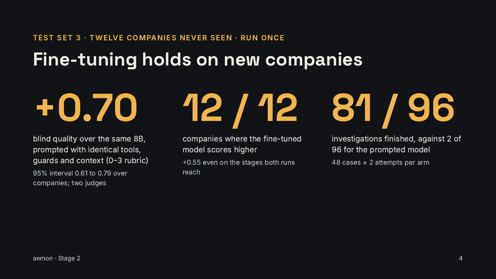
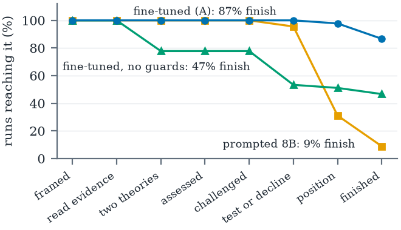

# Weights and Harness Are Complements: aemon-8b, a strategy investigator distilled into Aya Expanse 8B

*Try it: [the live demo](https://huggingface.co/spaces/twoeyedravens/aemon-8b) (any username, no password; it sleeps when idle, so the first visit takes a few minutes) · Paper: [Weights and Harness Are Complements](https://github.com/Two-Eyed-Ravens/aemon/blob/main/docs/stage2/PAPER_STAGE2.pdf) · [Slides](https://github.com/Two-Eyed-Ravens/aemon/blob/main/docs/stage2/SLIDES_STAGE2.pdf) · Code, every run and every decision: [github.com/Two-Eyed-Ravens/aemon](https://github.com/Two-Eyed-Ravens/aemon) · Model: [twoeyedravens/aemon-8b](https://huggingface.co/twoeyedravens/aemon-8b) · Data: [datasets/twoeyedravens/aemon-8b](https://huggingface.co/datasets/twoeyedravens/aemon-8b) · [Collection](https://huggingface.co/collections/twoeyedravens/aemon-a-strategy-investigation-agent-6b02e96de429ffe04b279dcf)*

*weigh what is known. test what is not.*

Team Two-Eyed Ravens · Lexsi AI Hackathon, Track 3 (Agentic Fine-Tuning), Stage 2 · November 2026

> **Two stages, one project.** The Lexsi hackathon ran in two rounds. In **Stage 1** (1–15 November) we built aemon: an agent that investigates a strategy question through twelve guarded tools over verified dossiers of real manufacturers, distilled from a teacher (Command A+) into a small open student, Tiny Aya 3.35B, with AgentTune. It beat its prompted base by +0.83 and +0.52 on two frozen tests ([Stage 1 article](https://huggingface.co/blog/HatemSaadallah/aemon)). **Stage 2** (19–24 November), this article, moves the student to Aya Expanse 8B, tests it on twelve companies it has never seen, and measures which parts of the agent earn their place.

**One-line claim.** Distilling a teacher's investigations into Aya Expanse 8B with AgentTune makes it a far better strategy investigator on twelve companies it has never seen, **+0.70 [0.61, 0.79]** in blind quality over the same model prompted with the same tools, at all twelve, and the fine-tuned weights still need the harness around them: each part adds to the other.

*The Stage 2 slides: [open the full deck (PDF)](https://github.com/Two-Eyed-Ravens/aemon/blob/main/docs/stage2/SLIDES_STAGE2.pdf).*

**Tracks and problem statements covered**

- Track 3, Agentic Fine-Tuning, problem statement 3: **Agentic distillation**.
- Track 3, problem statement 7: **Business workflow and decision agents**.

**Headline, before → after** (test set 3: twelve new companies, 96 runs per arm, run once, two blind LLM judges, 0–3 rubric)

| | Prompted Aya Expanse 8B | **Fine-tuned Aya Expanse 8B** |
|---|---|---|
| Blind quality (mean of two judges) | 1.01 | **1.71** |
| Investigations finished | 2 of 96 | **81 of 96** |
| Tool calls accepted by the environment | 79.8% | **92.4%** |

**Base model and method, in one line.** Aya Expanse 8B (CohereLabs, CC-BY-NC-4.0), LoRA rank 16 on all seven linear projections, trained with AgentTune's distillation trainer and Unsloth on 3,891 Command A+ tool calls that replay exactly in our environment, evaluated with AuditKIT replay and two blind LLM judges on a test set frozen before any result of the fine-tuned model was opened.

### Abstract

Asked whether a manufacturer should take its technology to a new kind of customer, language models write consulting prose. Good strategy work does something else: it frames the decision, states rival causal theories, weighs evidence for and against each, designs a test that separates them, and revises when new evidence arrives. aemon is an agent that does this through twelve guarded tools. A quote that is not word for word in its source is refused, a second theory that restates the first is refused, and a simulated result can never stand in as evidence.

In Stage 1 we distilled that procedure into Tiny Aya Global (3.35B). In Stage 2 we asked two questions with a stronger Cohere student, Aya Expanse 8B: does fine-tuning on the teacher's trajectories still help a larger model on companies it has never seen, and which parts of the agent actually earn their place?

The answer to the first is yes, clearly. On development, fine-tuning lifts the 8B from finishing 9% of investigations to 87% and raises judged quality by +0.72, +0.88 and +0.77 at three training seeds, with general ability unchanged. On a fresh test set of twelve companies, run once, the fine-tuned 8B beats the same model prompted with an identical scaffold by +0.70 [0.61, 0.79] at every company.

The answer to the second is that the trained weights and the guards need each other, on held-out companies too: removing the guards from the fine-tuned 8B costs **−0.48 [0.31, 0.65]** on test set 3, lower at all twelve companies under both judges, with finished runs falling from 81 to 34. Fine-tuning lifts the share of tool calls the environment accepts from 80% to 92%, and every remaining unfinished run fails at one precise check, which makes the next round of training a targeted one. Along the way, two data additions that looked like gains at one training seed vanished over three, so we replicate before we believe.

aemon-8b is fully open: the weights, every run and judgment, and the code. Against a closed model, Claude Haiku 5.5, it trails on judged quality (by +0.20 [0.05, 0.35] as registered; +0.42 post hoc without 11 Haiku runs that ended on API refusals), and its case is control: it runs where the case data cannot leave, and every call is checked and replayable.

## 1. Problem and approach

**The problem.** A strategy decision, such as whether a hearing-protection maker should sell to consumers, is a bet on causes: who would change their behaviour, why, and what evidence would show it. Research on scientific decision making in firms (Camuffo et al., 2020, 2024) finds that treating such choices as theories to test leads to better decisions. A language model asked the same question produces fluent advice with no theories, no evidence it can be held to, and no test.

**The approach.** aemon turns the investigation into a procedure an environment can check. Twelve tools (read the brief, frame the decision, add a rival theory, search and read sources, assess a quote for or against a theory, design a test, take a position, revise it, finish) each enforce rules: quotes must match their source exactly, theories must differ, a simulated study result is labelled and refused as evidence. A teacher, Command A+, ran investigations through these tools; only those whose every call replays exactly became training rows; AgentTune distilled them into a LoRA adapter.

**What is new in Stage 2.** A larger student (Aya Expanse 8B); every design choice measured against one reference with matched training seeds; ablations of the guards, the adapter and four kinds of training data; and a new test set of twelve companies with simulated evidence that supports or undermines a theory, to test revision.

## 2. Hackathon repositories used

- **AgentTune** 1.1.3 (commit `d4db4c1`). Its distillation trainer (`agenttune.agentic.distill_trainer.create_distill_trainer`) trains every Stage 2 adapter, with Unsloth building the model (a training step 4.3 times faster than our earlier trainer in a matched test). Loss is on the target tool call only. Its event-log format (`agenttune.agentic.events`) is what every evaluated run is converted to.
- **AuditKIT** 1.1.3 (commit `71316da`). Replays every recorded investigation through the guarded tools and scores its calls (replay mismatches, valid tool names, redundant calls, loops, guards cleared). All four test set 3 arms, including Haiku, replay with zero mismatches. For eleven development reports the audit was skipped at run time, because one account's evaluation environment lacked AgentTune, which AuditKIT's replay imports; those audits were run afterwards on the saved trajectories, and every evaluation job now stops if either package is missing.

## 3. Models and licences

| Model | Role | Licence |
|---|---|---|
| Aya Expanse 8B (CohereLabs, revision `5062468b`) | the student | CC-BY-NC-4.0 |
| Command A+ (Cohere) | the teacher | Apache 2.0 |
| Tiny Aya Global (CohereLabs) | Stage 1's student, compared here | CC-BY-NC-4.0 |
| Codex (`gpt-6-sol`, codex-cli 0.170.0) and Claude Code (`claude-opus-5-5`) | blind judges | proprietary; evaluation only, never training data |
| Claude Haiku 5.5 | closed-model comparison arm | proprietary; evaluation only |

The trained adapter is CC-BY-NC-4.0, following Aya Expanse: research and non-commercial use.

## 4. Datasets and benchmarks, with licences

- **Dossier**: short verbatim excerpts of public pages about real manufacturers, each with its URL and date, checked mechanically against the live page. 2,188 records, including test set 3's 230.
- **Training data**: 3,891 replay-exact Command A+ rows from 158 investigations on 57 training companies, plus 51 correction rows; the same teacher data as Stage 1.
- **Development**: 15 cases of six validation companies, 3 attempts each (45 runs per arm), one judge.
- **Test set 3**: twelve companies never used before (Biesse, Brembo, Eberspächer, Gühring, Kardex, Krones, Lapp, MULTIVAC, Nabtesco, Rieter, Sika, Tomra), seven drawn by a rule committed before any research; four cases per company, including a pair of simulated randomized tests whose mirrored outcomes support or undermine one theory; frozen by digest. 48 cases x 2 attempts = 96 runs per arm.

Excerpts are quotations of public sources for research; the cases support evaluating evidence-grounded reasoning, not commercial decisions about the named companies.

## 5. Model artifacts

[twoeyedravens/aemon-8b](https://huggingface.co/twoeyedravens/aemon-8b): `aemon-8b-adapter.gguf`, the adapter exactly as served in every evaluation, and `peft/`, the PEFT adapter it was converted from. The [live demo](https://huggingface.co/spaces/twoeyedravens/aemon-8b) serves it on one GPU with the full interface. Part of the [aemon collection](https://huggingface.co/collections/twoeyedravens/aemon-a-strategy-investigation-agent-6b02e96de429ffe04b279dcf).

## 6. Data artifacts

[datasets/twoeyedravens/aemon-8b](https://huggingface.co/datasets/twoeyedravens/aemon-8b): every development screen, blind packet, judgment and answer key; test set 3's frozen cases and dossiers, the runs of all four arms, both judges' predictions and the analysis; the rows added by every data condition. The dataset viewer has five tables (the test set 3 key and packets, each judge's judgments, the development key). Every file is listed in `MANIFEST.json` with the sha256 of its source.

## 7. Experiments and findings

Every rule (which configuration to test, how to read it, what counts as a gain) was written in the dated [decision log](https://github.com/Two-Eyed-Ravens/aemon/blob/main/docs/DECISIONS.md) before its result existed; deviations are marked as such.

### Test set 3, run once

| Arm | Mean quality (two judges) | Finished | Tool calls accepted | Calls per finished run | Median model seconds per run |
|---|---|---|---|---|---|
| Prompted Aya Expanse 8B | 1.01 | 2 of 96 | 79.8% | 1,135 | 73 |
| Stage 1 system (Tiny Aya 3.35B, two adapters) | 1.58 | 82 of 96 | 91.2% | 44 | 105 |
| **Fine-tuned Aya Expanse 8B** | **1.71** | **81 of 96** | **92.4%** | **44** | **125** |
| Claude Haiku 5.5 | 1.92 | 70 of 91 | 87.2% | 25 | 49 |

- **Fine-tuned minus prompted: +0.70 [0.61, 0.79]** over companies, higher at all twelve. Codex +0.79, Claude Code +0.61. On the stages both runs reach, still +0.55 [0.44, 0.66], so the gain is not only finishing more.
- **Against the Stage 1 system: +0.12 [0.05, 0.20]**, near zero at four companies, and the two finish as often. Against a fine-tuned 3.35B with the same guards, the larger model adds little: most of the gain comes from fine-tuning and the guards.
- **Against Claude Haiku 5.5** (added after the main result, rule registered before its run; Stage 1's settings: its staged prompt, none of the six guards): Haiku leads by **+0.20 [0.05, 0.35]** as registered, +0.44 on shared stages. 11 of its 91 runs ended on API refusals (empty responses with stop reason "refusal"), stopped by the harness as repeated errors; read post hoc without them, Haiku leads by **+0.42 [0.32, 0.52]** at all twelve companies and finishes 70 of 80. Claude Code, of Haiku's own model family, gives it +0.30 as registered; Codex +0.12. Haiku costs $0.008 per investigation; the 8B about $0.02 self-hosted.
- **The baseline**: the headline uses the 8B prompted with the fine-tuned agent's own compact prompt and guards. Under its best prompt the prompted 8B finishes 27 of 45 development runs, and the fine-tuned agent still leads by +0.60 [0.49, 0.70].
- **What still fails**: all 15 of the fine-tuned 8B's unfinished runs end the same way: the environment refuses `finish` because the recommendation cites a simulated result as evidence, and the agent does not recover.
- **Runs and packets**: decoding is greedy, so the second attempt often repeats the first (the fine-tuned 8B has 81 distinct runs of 96). Identical runs share one blind packet; intervals are over companies, so repeats do not narrow them.
- Seconds are model time on different hardware per arm (A100 slices for the local models, Anthropic's API for Haiku), so latency is rough.

### Why it works: weights and harness are complements

**On test set 3** (registered before its run): the fine-tuned 8B without its guards scores 1.23 and finishes 34 of 96, against 1.71 and 81 of 96 with them. The guards add **+0.48 [0.31, 0.65]**, at all twelve companies, under both judges (Codex +0.50, Claude Code +0.46). Without guards it still beats the prompted 8B with them, +0.22 [0.01, 0.43].

**On development** (seed 7, one judge):

Each model under its best prompt, with and without the six guards (finished of 45, judged score):

| | No guards | Six guards |
|---|---|---|
| Prompted 8B | 32 (not judged) | 27 (1.41) |
| **Fine-tuned 8B** | 21 (1.57) | **39 (2.01)** |

Fine-tuning alone finishes fewer runs than prompting alone, and guards alone don't help the prompted model; together they finish the most and score highest. Removing one part at a time from the fine-tuned system:

| Removed from the fine-tuned system | Change in quality | Finished (of 45; full system 39) |
|---|---|---|
| Resampling a repeated call (refuse it instead) | −0.49 [−0.70, −0.31] | 13 |
| All six decoding guards | −0.43 [−0.66, −0.23] | 21 |
| The compact prompt it was trained in (Stage 1's staged prompt) | −0.20 [−0.32, −0.07] | 26 |
| The adapter in the late stages (base weights there) | −0.19 [−0.29, −0.10] | 18 |
| Quote menu · belief ledger · budget guard | −0.05 · −0.01 · +0.01 | |

The fine-tuned model still needs one guard, and the guards still need the fine-tuned weights, after the evidence is gathered too.

### Replication: one finding holds, three "gains" did not (development, three training seeds)

| Change (against) | Seed 7 | Seed 11 | Seed 13 | Pooled |
|---|---|---|---|---|
| **Fine-tuning** (prompted 8B) | +0.72 | +0.88 | +0.77 | holds at every seed |
| Rule-built recovery rows (A) | +0.18 | −0.20 | +0.08 | +0.02 [−0.04, +0.09] |
| Teacher corrections of the student's own failure states (A) | +0.12 | −0.05 | −0.14 | −0.03 [−0.07, +0.02] |
| Rebalancing the teacher's rows toward rare skills (A) | −0.97 | −1.09 | −0.08 | −0.72 [−0.92, −0.50] |

Seed 7, the reference seed of every design step, made two data additions look like wins; over three seeds they vanish, and rebalancing by repetition makes the agent loop. 43 more teacher investigations (+27% data) gave +0.09 [−0.02, +0.19] at one seed: inconclusive.

### What else was tested

- **General ability**: 67.9% against the base's 67.3% on 800 MMLU and ARC-Challenge items: fine-tuning for the investigation left it intact.
- **A decision model** for one typed choice (the kind of evidence a quote is) improves its labels but not judged quality (+0.01 pooled over three seeds), so it is left out.
- **A step reward for RL**, built before any RL and checked by the tools, failed its registered agreement test with the judge (Spearman 0.26 against a 0.30 bar), so nothing was trained on it.
- **Judges**: they agree in sign on every comparison, but Claude Code scores every arm about 0.45 lower than Codex, and within an arm they agree only weakly on which run is better (Spearman 0.31 to 0.47). We therefore read differences between arms, never single runs.

### Limits

The judges are LLMs on a fixed rubric, and two small blind hand checks agreed with them on the direction of differences, not on the ranking of runs (rank correlations 0.17 and −0.20). The test ran one trained adapter, fixed in advance, so its interval covers companies and attempts; training-seed variation comes from development. Every case is a strategy question about a business-to-business manufacturer.

## 8. With more credits

We used Hugging Face credits to host the 8B agent as a live GPU demo. With more compute we would:

- **Run iterative teacher corrections of the student's own failure states**, judged at three seeds from the start, since one round gained only at seed 7.
- **Train with reinforcement learning** once a step reward passes its registered agreement test with the judges; our first one did not.
- **Run the test at equal cost against closed models**, and add a third judge outside both model families of the arms compared.

## 9. Team

Team Two-Eyed Ravens: [Hatem Saadallah](https://huggingface.co/HatemSaadallah) (@HatemSaadallah) and [Nour Jennane](https://huggingface.co/Nour1928) (@Nour1928), Master's students in artificial intelligence and AI researchers.

Built with AgentTune and AuditKIT (Lexsi Labs), Aya Expanse, Tiny Aya and Command A+ (Cohere), Unsloth, PEFT, TRL and llama.cpp, on NVIDIA A100 GPUs. Code: Apache 2.0; the adapter is CC-BY-NC-4.0.

### Reproduction

The repository's [README](https://github.com/Two-Eyed-Ravens/aemon#stage-2-in-detail) has the commands. `scripts/test3/analyze.py` recomputes test set 3 from the published key and judgments; `scripts/paper/check_numbers.py` recomputes every development comparison in the paper; `scripts/test3/track3_metrics.py` computes the Track 3 metrics. Training and evaluation: `jobs/train_base.sbatch` and `jobs/screen_bases.sbatch`.

### References

Camuffo, A., Cordova, A., Gambardella, A. and Spina, C. (2020). A scientific approach to entrepreneurial decision making. *Management Science* 66(2). · Camuffo, A., Gambardella, A. and Pignataro, A. (2024). Theory-driven strategic management decisions. *Strategy Science*. · Lexsi Labs: [AgentTune](https://agenttune.lexsi.ai/), [AuditKIT](https://auditkit.lexsi.ai/). · Cohere Labs: [Aya Expanse 8B](https://huggingface.co/CohereLabs/aya-expanse-8b), Command A+. · [Unsloth](https://github.com/unslothai/unsloth), Hugging Face [PEFT](https://github.com/huggingface/peft) and [TRL](https://github.com/huggingface/trl), [llama.cpp](https://github.com/ggml-org/llama.cpp). · Stage 1 article: [aemon](https://huggingface.co/blog/HatemSaadallah/aemon).
